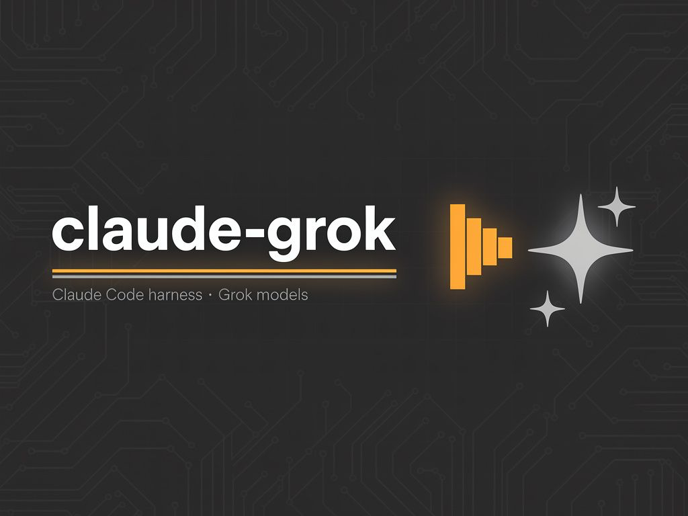
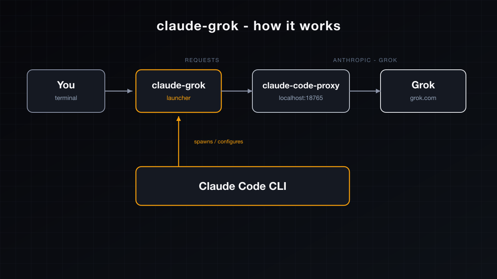

# claude-grok

<p align="center">
  
</p>

**Run [Claude Code](https://docs.anthropic.com/en/docs/claude-code) on Grok — and switch to Codex (or other proxy providers) with `/model`.**

A thin launcher that points Claude Code at a local Anthropic-compatible [`claude-code-proxy`](https://github.com/raine/claude-code-proxy) backed by your **grok.com** subscription and (optionally) **ChatGPT Codex**.

## How it works

<p align="center">
  
</p>

1. `claude-grok` starts (or reuses) a patched `claude-code-proxy` on `127.0.0.1:18765`
2. Sets `ANTHROPIC_BASE_URL` + gateway model discovery so Claude Code’s `/model` can list providers
3. The proxy routes each request by **model id** (Grok / Codex / Kimi / Cursor)

Claude Code stays the harness (tools, skills, hooks, MCP). The model is whatever you pick.

### `/model` switching (recommended path)

Claude Code only auto-discovers gateway ids that start with `claude` or `anthropic`. The proxy’s Codex aliases match that filter, so they show up in the picker. Grok does not — so the launcher pins it as a custom option.

| In `/model` | Routes to | Notes |
|-------------|-----------|--------|
| `claude-opus-4-7`, `claude-sonnet-4-6`, `claude-haiku-4-5`, `opus` / `sonnet` / `haiku` | **Codex** | **Use this for real work** — native tool_use, ~1s turns |
| Type `grok-4.5` | **grok.com Build** | Subscription Grok (default launch; 402 when Build exhausted) |
| **Cursor Grok 4.5 (experimental)** | `cursor:grok-4.5` | ACP agent wrap (T3 path). Slow + fights Claude Code tools — avoid for coding sessions |
| Type `cursor-plan:grok-4.5` | Cursor **Plan** mode + Grok | Optional; agent mode is the picker default |
| Type `gpt-5.6-sol`, `composer-2.5`, `kimi-k2.6`, … | matching provider | Works even if not listed |

```text
/model                          # open picker
/model                          # → pick "Cursor Grok 4.5 High"
/model grok-4.5                 # grok.com Build
/model cursor-plan:grok-4.5     # Cursor Plan mode
/model claude-sonnet-4-6        # Codex
/model gpt-5.6-sol              # Codex (type the id)
```

Enablement is automatic in the launcher (`CLAUDE_CODE_ENABLE_GATEWAY_MODEL_DISCOVERY=1`).

### Why the bridge? (optional fallback)

Claude Code `Read(png/jpg/...)` returns `tool_result` children with `"type":"image"`.
Stock Homebrew `claude-code-proxy` (≤0.1.25) hard-fails those on the Grok path with:

```text
API Error: 400 tool result supports text children only
```

**Preferred fix:** run the patched proxy (v0.1.25 + [PR #69](https://github.com/raine/claude-code-proxy/pull/69)) with
`CCP_GROK_TOOL_IMAGE=reattach` so Grok actually receives the images.
See [docs/PATCHED-PROXY.md](./docs/PATCHED-PROXY.md).

`claude-grok-bridge` remains as an optional sanitize fallback
(`CLAUDE_GROK_DISABLE_BRIDGE=0`) that rewrites image children to text placeholders.

## Install

```bash
git clone https://github.com/DevvGwardo/claude-grok.git
cd claude-grok
./install.sh
```

### Prerequisites

```bash
# 1) Claude Code CLI
# https://docs.anthropic.com/en/docs/claude-code

# 2) Local Anthropic↔provider proxy
brew install raine/claude-code-proxy/claude-code-proxy
claude-code-proxy grok auth login
# Optional but recommended for /model Codex rows:
claude-code-proxy codex auth login
# Or keep the official Codex CLI logged in — claude-grok imports ~/.codex/auth.json

brew services start raine/claude-code-proxy/claude-code-proxy
```

## Usage

```bash
claude-grok                          # grok-4.5 (default)
claude-grok grok-composer-2.5-fast
claude-grok gpt-5.6-sol              # Codex
claude-grok claude-sonnet-4-6        # Codex alias
claude-grok models                   # full proxy catalog
claude-grok auth                     # provider auth status (+ Codex sync)
claude-grok -p "say hi"
```

Inside a session, use `/model` to switch without restarting.

Optional env knobs:

| Var | Default | Meaning |
|-----|---------|---------|
| `CLAUDE_GROK_MODEL` | `grok-4.5` | Default session model |
| `CLAUDE_GROK_SMALL_MODEL` | `claude-haiku-4-5` | Background / small-fast (Codex) |
| `CLAUDE_GROK_OPUS_MODEL` | `claude-opus-4-7` | `/model opus` → Codex |
| `CLAUDE_GROK_SONNET_MODEL` | `claude-sonnet-4-6` | `/model sonnet` → Codex |
| `CLAUDE_GROK_HAIKU_MODEL` | `claude-haiku-4-5` | `/model haiku` → Codex |
| `CLAUDE_GROK_SUBAGENT_MODEL` | sonnet default | Subagent model |
| `CLAUDE_GROK_CUSTOM_MODEL` | `cursor:grok-4.5` | Extra `/model` picker row (Cursor plan Grok) |
| `CLAUDE_GROK_CUSTOM_MODEL_NAME` | `Cursor Grok 4.5 High` | Picker label |
| `CLAUDE_GROK_SYNC_CODEX` | `1` | Import `~/.codex/auth.json` into the proxy |
| `CLAUDE_GROK_SYNC_CURSOR` | `1` | Import Cursor IDE keychain tokens into the proxy |
| `CLAUDE_GROK_BASE_URL` | proxy `:18765` (or bridge `:18766`) | URL Claude Code hits |
| `CLAUDE_GROK_UPSTREAM` | `http://127.0.0.1:18765` | Real `claude-code-proxy` URL |
| `CLAUDE_GROK_PROXY_BIN` | `~/.local/bin/claude-code-proxy` if present | Proxy binary |
| `CLAUDE_GROK_DISABLE_BRIDGE` | `1` | Set `0` to enable sanitize bridge fallback |
| `CCP_ALIAS_PROVIDER` | `codex` | Where `opus`/`sonnet`/`haiku` aliases route |

## Models

```bash
claude-grok models
claude-code-proxy models
claude-grok auth
```

Typical ids:

- **Cursor plan Grok:** `cursor:grok-4.5` (agent), `cursor-plan:grok-4.5` (plan mode)
- **grok.com Build:** `grok-4.5`, `grok-composer-2.5-fast`
- **Codex:** `gpt-5.6-sol`, `gpt-5.6-luna`, `claude-sonnet-4-6`, `claude-opus-4-7`, `claude-haiku-4-5`, …
- **Cursor / Kimi other:** see `claude-code-proxy models` (auth required)

## Notes / limits

- Auth is **owned by the proxy** (`~/.config/claude-code-proxy/<provider>/`). Grok does **not** auto-reuse `~/.grok/auth.json`. Codex can be seeded from `~/.codex/auth.json` on launch. Cursor can be seeded from the IDE keychain (`cursor-access-token` / `cursor-refresh-token`).
- Gateway discovery ignores non-`claude*`/`anthropic*` ids — the launcher pins **Cursor Grok** (`cursor:grok-4.5`) as the custom picker row; type `grok-4.5` for grok.com Build.
- The proxy binds to loopback and accepts unauthenticated local clients — keep it on `127.0.0.1`.
- Unofficial subscription clients may carry account / ToS risk. Use at your own risk.
- Prefer the **patched proxy** ([docs/PATCHED-PROXY.md](./docs/PATCHED-PROXY.md)) so `Read(png)` works with Grok vision (`CCP_GROK_TOOL_IMAGE=reattach`).
- If grok.com Build is exhausted, pick **Cursor Grok 4.5 High** or a Codex id. Cursor itself may still 429 (`resource_exhausted`) under its own plan limits.
- Cursor models (`cursor:grok-4.5`, etc.) default to **`CCP_CURSOR_TRANSPORT=acp`**: the proxy speaks Agent Client Protocol to `cursor-agent acp` (same path as T3 Chat). The ACP harness forces Claude Code `tool_use` XML (Skill/Read/Bash/…) and denies Cursor-native client tools — otherwise Grok narrates "Skill isn't available" and never calls Claude Code tools. Set `cli` to roll back to `cursor-agent -p`, or `api` to debug the Connect protobuf client.
- This repo is a launcher + optional sanitize bridge + docs. Upstream protocol work lives in [raine/claude-code-proxy](https://github.com/raine/claude-code-proxy).

## Related

- [claude-code-proxy](https://github.com/raine/claude-code-proxy) — Anthropic-shaped local proxy (Codex / Kimi / Grok / Cursor)
- [Claude Code model config / gateway discovery](https://code.claude.com/docs/en/model-config)
- [Claude Code](https://docs.anthropic.com/en/docs/claude-code)
- [Grok](https://grok.com)

## License

MIT
